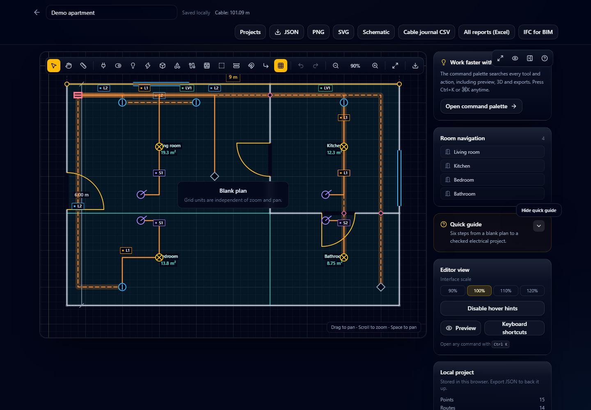
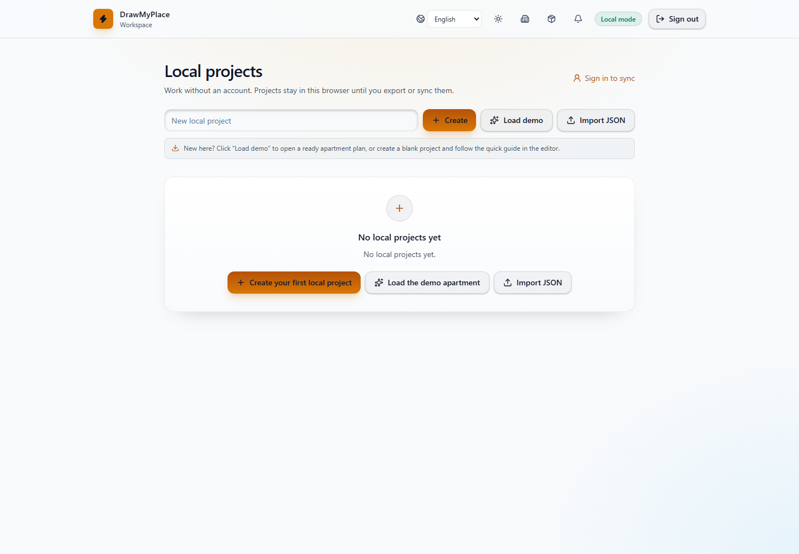
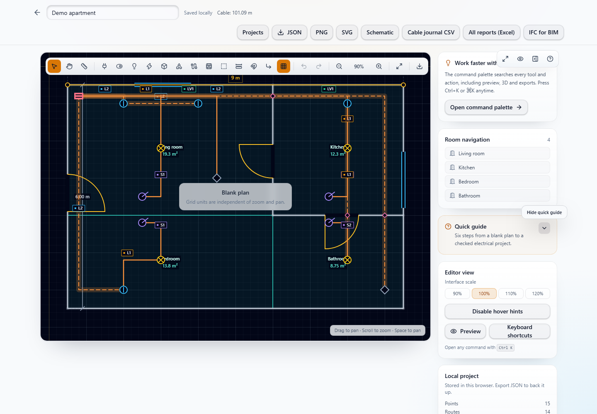

# Editor guide

A practical guide to the DrawMyPlace plan editor, electrical workflow and exports.

## Workspace

- The left side is the drawing canvas; the right sidebar holds navigation, guidance, circuits, calculation, validation and export panels.
- The header switches language, theme and account actions. Local projects show **Saved locally** and can be synced to an account.
- The top toolbar groups selection, walls, rooms, openings, cable routes, dimensions and point placement. Hover any tool to see its shortcut and hint.
- `Ctrl+K` (or `⌘K`) opens the command palette with every tool, view mode and export.

## Drawing

1. Calibrate the underlay with a known distance before relying on lengths or costs.
2. Trace walls, then add doors and windows. Rooms can be drawn directly or detected from closed walls.
3. Place devices from the palette or the device library. Use `S`, `W`, `L`, `B` and `J` for sockets, switches, lights, boards and junction boxes.
4. Draw cable routes from the board to devices. Route ends snap to points; the magnet control pins or detaches an end.
5. Assign a circuit to every route so load, voltage drop and protection checks can run.

## Full screen and preview

- The full-screen button (or `F11`/`Shift+F` while the editor is focused) uses the browser Fullscreen API and keeps the panels available.
- **Preview** hides panels and locks editing for a clean presentation. It composes with full screen into a kiosk view.

## Hover hints

Hovering a point, route, wall, room, opening or dimension shows a compact tooltip with the most useful fields – circuit, mounting, cable breakdown, wall area, room area/perimeter, opening fit and dimension value. Hover hints can be disabled in **Editor view**; the preference is stored per browser. On touch screens, long-press shows the same hint.

## Validation and clashes

The Validation panel updates while you draw. It covers missing circuits, unknown materials, cable/breaker coordination, voltage drop, fault current, RCD requirements, panel fill and normocontrol against ПУЕ/ДБН. Wet rooms add a 30 mA RCD requirement for sockets and warn about junction boxes.

Cable-route clashes are reported on the same panel and as red/amber markers in the 3D view. Click a row to jump to the affected route or device.

## Device library

The **Device library** panel searches standard articles by manufacturer, series, order code, rating or name. Each card shows the symbol, IEC/ДСТУ standard, indicative price and optional material code.

- **Place** starts the placement tool with the product attached to the new point.
- **Assign** attaches the article to the selected device.
- The article appears in the point properties and in the equipment report, including manufacturer, order code and total cost.

## Reports and exports

The editor export panel and the documentation workspace provide:

| Export | Contents |
| --- | --- |
| Plan SVG | Walls, openings, rooms, dimensions, points and routes |
| Schematic SVG | Single-line schematic with automatic circuit/breaker/wire/terminal numbering |
| Cable journal CSV | Circuit address, protection, cable, length and device/route counts |
| Reports (Excel) | Equipment specification, cable journal and panel schedule in one XLSX workbook |
| IFC for BIM | IFC4 file with walls, openings, spaces, devices and cable segments |
| Project JSON | Full project snapshot with floors and drawings |

Report templates let you choose fields per report; the selection is remembered. Equipment rows can include manufacturer, article, unit price and total cost. PDF output uses the browser print dialog with a print-specific light stylesheet.

IFC export uses the calibrated scale. If a plan is not calibrated, the button warns that one drawing unit is treated as 1 cm.

## Local mode

`/local` stores projects in IndexedDB without an account. You can export JSON, import it on another device, and sync a local project to an account later. The demo apartment is a good place to explore circuits, routes, reports and IFC export.

## Onboarding

A new account sees a five-step editor tour once: tools → canvas → circuits → validation → autosave. The tour can be skipped with `Esc`, and completion is stored locally and on the account.

After the tour, contextual cards suggest the next useful action (first route, first circuit, command palette, 3D view, documentation). They are one-time and dismissible.

- Replay the tour: append `?tour=editor` to the editor URL.
- Disable it: append `?tour=off`.

## Light theme

Panels, documentation and public pages follow the light theme; the drawing canvas intentionally stays dark for line contrast.

## Troubleshooting

- **No lengths or costs** – calibrate the plan first.
- **Validation is empty** – confirm that circuits exist and routes are assigned.
- **Excel does not open** – the file is a real `.xlsx` workbook; check that the download was not renamed by the browser.
- **IFC model is huge** – each wall segment is exported separately; split very long walls only when needed.
- **Local project is missing** – local data is per browser and per origin; export JSON before clearing site data.
